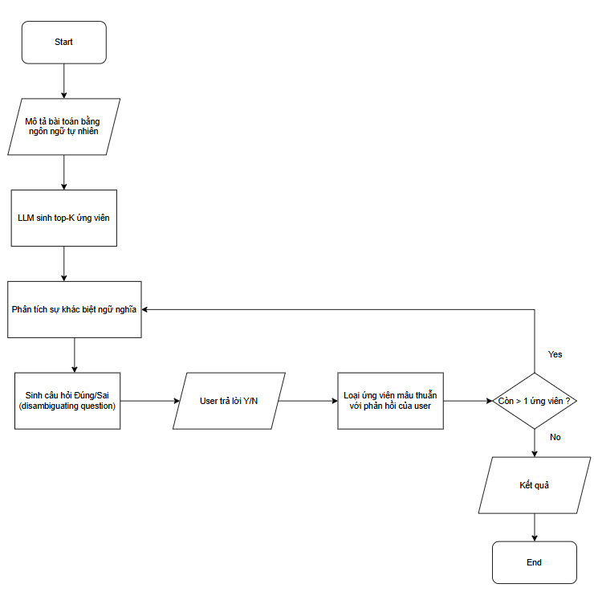

# SEMSYNTH Lite — Báo cáo Giai đoạn 1: Khảo sát và Định hình Dự án

> **Dự án:** SEMSYNTH Lite — Hệ thống tổng hợp chương trình tương tác người dùng qua hỏi-đáp ngữ nghĩa  
> **Môn học:** Đồ án tổng hợp AI (HK1/2026–2027)  
> **Giai đoạn:** Tuần 1–2 (Khảo sát & Định hình)  
> **Ngày lập:** 16/09/2026

---

## Mục lục

1. [Problem Statement & Objectives](#1-problem-statement--objectives)
2. [Scope & Primary Use Cases](#2-scope--primary-use-cases)
3. [Literature / Solution Survey](#3-literature--solution-survey)
4. [Bảng so sánh các phương pháp](#4-bảng-so-sánh-các-phương-pháp-method-comparison-table)
5. [Đề xuất Baseline](#5-đề-xuất-baseline)
6. [Danh sách Dataset & Data Sources](#6-danh-sách-dataset--data-sources)
7. [Sơ bộ Technology Stack](#7-sơ-bộ-technology-stack)

---

## 1. Problem Statement & Objectives

### 1.1 Problem Statement — Khoảng cách Ma sát Nhận thức (Cognitive Friction Gap)

Trong lĩnh vực **Tổng hợp chương trình (Program Synthesis)**, hai hướng tiếp cận phổ biến hiện nay đều tồn tại hạn chế lớn về trải nghiệm người dùng:

| Hướng tiếp cận | Hạn chế cốt lõi |
|---|---|
| **Lập trình qua Ví dụ (PBE)** | Buộc người dùng phải tự nghĩ ra các cặp Input-Output đầy đủ, chính xác — một việc đòi hỏi **gánh nặng nhận thức (cognitive load) rất cao**, đặc biệt khi bài toán phức tạp hoặc có nhiều trường hợp biên (edge cases). |
| **Dùng LLM trực tiếp** | Cho phép mô tả bài toán bằng ngôn ngữ tự nhiên (NL), nhưng do NL vốn **mơ hồ và thiếu hình thức hóa**, LLM dễ sản sinh mã sai hoặc không đúng ý (hiện tượng **ảo giác — hallucination**). |

> **Cognitive Friction Gap** (Khoảng cách ma sát nhận thức) là khoảng trống giữa **ý định thực sự** của người dùng và **khả năng diễn đạt** ý định đó thông qua các giao diện hiện có (ví dụ I/O hoặc prompt NL). Khoảng cách này là nguyên nhân gốc rễ dẫn đến mã sinh ra không khớp với mong muốn.

```
┌──────────────────┐       Cognitive Friction Gap        ┌──────────────────┐
│   Ý ĐỊNH THỰC    │◄══════════════════════════════════►│  KHẢ NĂNG DIỄN   │
│   CỦA NGƯỜI DÙNG │         (Khoảng trống)              │  ĐẠT CỦA GIAO   │
│                  │                                     │  DIỆN HIỆN CÓ    │
└──────────────────┘                                     └──────────────────┘
        │                                                         │
        │  PBE: Phải nghĩ ra I/O ──► Tải nhận thức cao           │
        │  LLM: Mô tả NL mơ hồ ──► Ảo giác, sai ý              │
        └─────────────────────────────────────────────────────────┘
```

### 1.2 Objectives — Mục tiêu của SEMSYNTH Lite

SEMSYNTH Lite đề xuất một phương pháp **cầu nối** nhằm thu hẹp Cognitive Friction Gap:

> **Xây dựng hệ thống tương tác chủ động** (proactive interaction system) đặt các **câu hỏi làm rõ ở mức ngữ nghĩa** (Semantic Clarification Questions) dưới dạng **Đúng/Sai (Yes/No)** để:
>
> 1. **Thu hẹp không gian chương trình ứng viên** (candidate program space) sau mỗi vòng hỏi-đáp.
> 2. **Giảm thiểu tải nhận thức** cho người dùng — chỉ cần trả lời Đúng/Sai thay vì tự nghĩ ví dụ phức tạp.
> 3. **Tăng độ chính xác** của mã sinh ra so với phương pháp gọi LLM 1-shot trực tiếp.

**Các mục tiêu định lượng kỳ vọng:**

| Tiêu chí | Baseline (CoT 1-shot) | SEMSYNTH Lite (kỳ vọng) |
|---|---|---|
| Success Rate (pass@1) | ~55–65% | ≥ 75–85% |
| Số vòng tương tác trung bình | 0 | 2–4 câu hỏi |
| Loại tương tác | Không có | Đúng/Sai (tải nhận thức thấp) |

---

## 2. Scope & Primary Use Cases

### 2.1 Phạm vi (Scope)

SEMSYNTH Lite giới hạn xử lý bài toán trong **2 miền chính**:

| Miền | Mô tả | Ví dụ |
|---|---|---|
| **Xử lý chuỗi (String Transformation)** | Các thao tác biến đổi, trích xuất, định dạng chuỗi | Đảo ngược chuỗi, tách từ, loại bỏ ký tự đặc biệt, chuyển đổi định dạng tên |
| **Thao tác danh sách (List Manipulation)** | Các thao tác lọc, sắp xếp, biến đổi trên mảng/danh sách | Loại bỏ phần tử trùng, lọc số chẵn, tính tổng điều kiện, gộp danh sách |

### 2.2 Luồng xử lý tổng quan (Processing Pipeline)

```
┌───────────────┐     ┌─────────────────────────────────────────┐     ┌──────────────┐
│    INPUT      │     │              PROCESSING                 │     │   OUTPUT     │
│               │     │                                         │     │              │
│ Mô tả bài    │────►│ 1. LLM sinh Top-K chương trình ứng viên │────►│ Mã Python    │
│ toán dạng NL  │     │ 2. Hệ thống đặt câu hỏi Đúng/Sai      │     │ hoàn chỉnh   │
│ (Tiếng Anh)   │     │ 3. Người dùng trả lời                  │     │ (đã tinh lọc)│
│               │     │ 4. Lọc bớt ứng viên không phù hợp      │     │              │
│               │     │ 5. Lặp lại bước 2–4 đến khi hội tụ     │     │              │
└───────────────┘     └─────────────────────────────────────────┘     └──────────────┘
```

### 2.3 Primary Use Cases

#### UC-01: Khởi tạo mô tả bài toán

| Thuộc tính | Chi tiết |
|---|---|
| **Actor** | Người dùng (User) |
| **Trigger** | Người dùng nhập mô tả bài toán bằng ngôn ngữ tự nhiên |
| **Precondition** | Hệ thống đã sẵn sàng, LLM API khả dụng |
| **Main Flow** | 1. Người dùng nhập mô tả NL (ví dụ: *"Write a function that removes duplicate elements from a list"*) <br> 2. Hệ thống gửi prompt đến LLM để sinh Top-K chương trình ứng viên (K = 5) <br> 3. Hệ thống phân tích sự khác biệt ngữ nghĩa giữa các ứng viên <br> 4. Hệ thống hiển thị cho người dùng rằng đã nhận yêu cầu và bắt đầu quá trình làm rõ |
| **Postcondition** | Hệ thống có Top-K chương trình ứng viên và sẵn sàng đặt câu hỏi |

#### UC-02: Trả lời câu hỏi làm rõ ngữ nghĩa (Đúng/Sai)

| Thuộc tính | Chi tiết |
|---|---|
| **Actor** | Người dùng (User) |
| **Trigger** | Hệ thống phát hiện sự mơ hồ giữa các chương trình ứng viên |
| **Precondition** | Có ≥ 2 chương trình ứng viên còn lại |
| **Main Flow** | 1. Hệ thống tạo test input phân biệt (distinguishing input) để tách nhóm ứng viên <br> 2. Hệ thống sinh câu hỏi ngữ nghĩa Đúng/Sai (ví dụ: *"Should the function preserve the original order of elements? Yes/No"*) <br> 3. Người dùng trả lời Yes hoặc No <br> 4. Hệ thống loại bỏ các ứng viên mâu thuẫn với câu trả lời <br> 5. Lặp lại cho đến khi chỉ còn 1 ứng viên hoặc đạt giới hạn câu hỏi |
| **Postcondition** | Không gian ứng viên được thu hẹp |

#### UC-03: Nhận kết quả mã nguồn đã tinh lọc

| Thuộc tính | Chi tiết |
|---|---|
| **Actor** | Người dùng (User) |
| **Trigger** | Quá trình hỏi-đáp hoàn tất (chỉ còn 1 ứng viên hoặc hết câu hỏi) |
| **Precondition** | UC-01 và UC-02 đã hoàn thành |
| **Main Flow** | 1. Hệ thống chọn chương trình ứng viên tốt nhất (top-ranked) <br> 2. Hệ thống hiển thị mã Python hoàn chỉnh kèm giải thích <br> 3. Người dùng có thể sao chép, chạy thử, hoặc yêu cầu tinh chỉnh thêm |
| **Postcondition** | Người dùng nhận được mã Python chính xác |

---

## 3. Literature / Solution Survey

### 3.1 Nhóm 1 — PBE: Programming by Example (FlashFill / PROSE)

**Đại diện:** FlashFill (Gulwani, 2011), PROSE Framework (Microsoft Research)

**Ý tưởng cốt lõi:**  
Người dùng cung cấp một số cặp Input-Output mẫu; hệ thống sử dụng kỹ thuật tìm kiếm trong không gian DSL (Domain-Specific Language) để tổng hợp chương trình thỏa mãn tất cả các ví dụ.

**Ưu điểm:**
- Chương trình sinh ra **tất định** (deterministic) — luôn cho kết quả nhất quán
- Không phụ thuộc vào LLM, tránh được hiện tượng ảo giác
- Đã được triển khai thương mại thành công (Excel FlashFill)

**Hạn chế:**
- **Tải nhận thức cao**: Người dùng phải tự nghĩ ra các cặp I/O đầy đủ, bao gồm cả edge cases
- Giới hạn trong DSL cố định, khó mở rộng sang bài toán phức tạp
- Khi có nhiều chương trình thỏa mãn ví dụ, khó chọn đúng ý người dùng

**Tài liệu tham khảo:**
- Gulwani, S. (2011). *Automating string processing in spreadsheets using input-output examples.* ACM SIGPLAN Notices.
- Polozov, O. & Gulwani, S. (2015). *FlashMeta: a framework for inductive program synthesis.* ACM OOPSLA.

---

### 3.2 Nhóm 2 — Direct LLM Code Generation (GPT-4 / Llama-3)

**Đại diện:** GPT-4, GPT-4o-mini (OpenAI), Llama-3 (Meta), CodeLlama

**Ý tưởng cốt lõi:**  
Sử dụng Large Language Model để sinh mã trực tiếp từ mô tả bài toán bằng ngôn ngữ tự nhiên (zero-shot hoặc few-shot prompting).

**Ưu điểm:**
- **Tải nhận thức thấp** ở bước input: Người dùng chỉ cần mô tả NL
- Linh hoạt, không bị giới hạn bởi DSL cố định
- Tốc độ sinh mã rất nhanh (vài giây)

**Hạn chế:**
- **Ảo giác (Hallucination)**: Khi prompt mơ hồ, LLM có thể sinh mã sai về logic hoặc xử lý edge case không đúng
- Kết quả **không tất định** (non-deterministic) — chạy lại có thể cho mã khác
- Thiếu cơ chế xác minh tự động
- Nhạy cảm với cách viết prompt (prompt sensitivity)

**Tài liệu tham khảo:**
- Chen, M. et al. (2021). *Evaluating Large Language Models Trained on Code.* arXiv:2107.03374 (Codex/HumanEval).
- Rozière, B. et al. (2024). *Code Llama: Open Foundation Models for Code.* arXiv:2308.12950.

---

### 3.3 Nhóm 3 — Interactive Clarification (TiCoder / ClarifyGPT)

**Đại diện:** TiCoder (Lahiri et al., 2023), ClarifyGPT (Mu et al., 2024)

**Ý tưởng cốt lõi:**  
Kết hợp LLM với cơ chế **đặt câu hỏi làm rõ** (clarification questions) để giảm thiểu sự mơ hồ trước khi sinh mã cuối cùng.

- **TiCoder:** Sử dụng **test case tự sinh** (auto-generated tests) làm phương tiện hình thức hóa từng phần (partial formalization). Các test cases giúp lọc và xếp hạng ứng viên mã nguồn.
- **ClarifyGPT:** Phát hiện **sự mơ hồ trong yêu cầu** bằng "code consistency check" — nếu LLM sinh ra nhiều phiên bản mã khác nhau cho cùng một prompt, điều đó chỉ ra sự mơ hồ. Hệ thống sau đó sinh câu hỏi làm rõ bằng NL cho người dùng.

**Ưu điểm:**
- Giảm đáng kể hiện tượng ảo giác so với LLM trực tiếp
- ClarifyGPT cải thiện Pass@1 lên đáng kể trên MBPP-sanitized
- Cơ chế tương tác tự nhiên, gần gũi với quy trình làm việc thực tế

**Hạn chế:**
- TiCoder: Người dùng vẫn cần **hiểu test case** để xác nhận — tải nhận thức chưa tối thiểu
- ClarifyGPT: Câu hỏi dạng mở (open-ended) → Câu trả lời NL có thể gây thêm sự mơ hồ
- Chưa có cơ chế hệ thống để chọn câu hỏi **tối ưu nhất** (maximally disambiguating)

**Tài liệu tham khảo:**
- Lahiri, S. K. et al. (2023). *Interactive Code Generation via Test-Driven User-Intent Formalization.* arXiv:2208.05950.
- Mu, F. et al. (2024). *ClarifyGPT: A Framework for Enhancing LLM-Based Code Generation via Requirements Clarification.* arXiv:2310.10996.

---

### 3.4 Nhóm 4 — SEMSYNTH (Phương pháp đề xuất)

**Ý tưởng cốt lõi:**  
SEMSYNTH Lite kế thừa hướng Interactive Clarification nhưng **đổi mới ở dạng câu hỏi**: sử dụng **câu hỏi ngữ nghĩa Đúng/Sai** (Semantic Yes/No Questions) thay vì câu hỏi mở hoặc test case.

**Quy trình hoạt động:**

<!-- ```
Mô tả NL ──► LLM sinh Top-K ứng viên ──► Phân tích sự khác biệt ngữ nghĩa
                                                     │
                                                     ▼
                                          Sinh câu hỏi Đúng/Sai
                                          (disambiguating question)
                                                     │
                                                     ▼
                                          Người dùng trả lời Y/N
                                                     │
                                                     ▼
                                          Loại ứng viên mâu thuẫn
                                                     │
                                              ┌──────┴──────┐
                                              │ Còn > 1?    │
                                              └──────┬──────┘
                                             Yes ──► Lặp lại
                                             No  ──► Trả kết quả
``` -->



> Sơ đồ khái quát do Bảo bổ sung. Trong prototype hiện tại, vòng lặp còn dừng khi hết ngân sách câu hỏi, không tìm được câu hỏi phân biệt hoặc không còn ứng viên. Một ứng viên còn lại chưa chứng minh mã đúng trên các đầu vào mới.

**Ưu điểm so với các phương pháp trước:**

| Tiêu chí | PBE | Direct LLM | TiCoder | ClarifyGPT | **SEMSYNTH** |
|---|---|---|---|---|---|
| Tải nhận thức | Rất cao | Thấp | Trung bình | Trung bình | **Rất thấp** |
| Dạng tương tác | I/O pairs | Prompt NL | Test cases | NL mở | **Đúng/Sai** |
| Kiểm soát mơ hồ | Cao (tất định) | Thấp | Trung bình | Khá | **Cao** |

**Điểm mới (Novelty):**
1. **Semantic Yes/No Questions**: Câu hỏi được thiết kế ở mức ngữ nghĩa (về hành vi chương trình), không phải ở mức cú pháp hay test case cụ thể
2. **Greedy Disambiguation**: Mỗi câu hỏi được chọn sao cho phân chia tập ứng viên **đều nhất có thể** (gần 50/50), tối đa hóa thông tin thu được
3. **Minimal Cognitive Load**: Người dùng chỉ cần hiểu câu hỏi NL và trả lời Yes/No

---

## 4. Bảng so sánh các phương pháp (Method Comparison Table)

| Tiêu chí | PBE (FlashFill/PROSE) | Direct LLM (GPT-4/Llama-3) | Interactive (TiCoder/ClarifyGPT) | **SEMSYNTH Lite (Đề xuất)** |
|---|---|---|---|---|
| **Loại đầu vào (Input Type)** | Cặp Input-Output | Mô tả NL (prompt) | Mô tả NL + trả lời câu hỏi mở / test | Mô tả NL + trả lời Đúng/Sai |
| **Tải nhận thức người dùng (Cognitive Load)** | 🔴 Cao — phải tự tạo I/O pairs | 🟢 Thấp — chỉ viết NL | 🟡 Trung bình — cần hiểu test case hoặc trả lời NL mở | 🟢 **Rất thấp** — chỉ Yes/No |
| **Độ phức tạp xử lý (Processing Complexity)** | 🟡 Trung bình — tìm kiếm DSL | 🟢 Thấp — 1 lần gọi LLM | 🟡 Trung bình — nhiều vòng LLM + test gen | 🟡 Trung bình — K lần sinh + N vòng hỏi |
| **Tỷ lệ thành công TB (Avg. Success Rate)** | ~70–80% (trong DSL) | ~55–65% (zero/one-shot) | ~70–80% | 🎯 **≥ 75–85%** (kỳ vọng) |
| **Khả năng mở rộng** | 🔴 Thấp — giới hạn DSL | 🟢 Cao — bất kỳ miền nào | 🟢 Khá — phụ thuộc LLM | 🟢 Khá — phụ thuộc LLM |
| **Tất định (Deterministic)** | ✅ Có | ❌ Không | ❌ Không | ❌ Không (nhưng hội tụ tốt hơn) |
| **Cần LLM** | ❌ Không | ✅ Có | ✅ Có | ✅ Có |
| **Số vòng tương tác** | 0 (batch) | 0 (one-shot) | 1–5 (mở) | 2–4 (Yes/No) |

> **Nhận xét:** SEMSYNTH Lite nhắm tới **điểm cân bằng tối ưu** giữa tải nhận thức thấp (như Direct LLM) và tỷ lệ thành công cao (như PBE/Interactive), thông qua cơ chế câu hỏi Đúng/Sai đơn giản nhưng hiệu quả.

---

## 5. Đề xuất Baseline

### 5.1 Baseline chính: Baseline CoT (Chain-of-Thought)

**Mô tả:**  
Gọi LLM sinh mã **1-shot trực tiếp** (zero-interaction) từ mô tả bài toán ban đầu, có sử dụng kỹ thuật Chain-of-Thought prompting để LLM "suy luận từng bước" trước khi viết mã.

**Quy trình Baseline CoT:**

```
Mô tả NL ──► Prompt CoT ──► LLM ──► Mã Python ──► Chạy test cases ──► Pass/Fail
```

**Tại sao chọn CoT làm Baseline?**
- CoT là kỹ thuật prompting **mạnh nhất hiện tại** cho LLM — đảm bảo baseline công bằng, không quá yếu
- Không có tương tác (0-interaction) → Làm nổi bật giá trị **thêm tương tác** của SEMSYNTH
- Dễ triển khai và tái lập (reproducible)

### 5.2 Mục tiêu đối chứng

| Tiêu chí so sánh | Baseline CoT | SEMSYNTH Lite |
|---|---|---|
| Tương tác | 0 vòng | 2–4 vòng (Đúng/Sai) |
| Success Rate (pass@1) trên dataset 15 bài | Đo thực tế | Đo thực tế |
| Thời gian trung bình | ~5–10s | ~30–120s (bao gồm thời gian người dùng trả lời) |

**Giả thuyết kiểm chứng (Hypothesis):**

> *H₁*: SEMSYNTH Lite đạt Success Rate **cao hơn có ý nghĩa thống kê** so với Baseline CoT trên tập 15–20 bài toán, với chi phí tương tác thấp (≤ 4 câu hỏi Đúng/Sai mỗi bài).

### 5.3 Mã nguồn Baseline

Mã nguồn Baseline CoT được cung cấp tại: [`src/baseline_cot.py`](file:///media/nguyen-dat/New%20Volume/HK1_261/Đồ%20án%20tổng%20hợp%20ttnt/src/baseline_cot.py)

---

## 6. Danh sách Dataset & Data Sources

### 6.1 Nguồn Benchmark

| Benchmark | Mô tả | Quy mô | Nguồn |
|---|---|---|---|
| **HumanEval** | 164 bài coding Python do OpenAI thiết kế, mỗi bài gồm function signature + docstring + hidden tests | 164 bài | [openai/human-eval](https://github.com/openai/human-eval) |
| **MBPP** | 974 bài Python cơ bản do Google Research crowdsource, mỗi bài gồm mô tả NL + 3 test cases | 974 bài | [google-research-datasets/mbpp](https://github.com/google-research-datasets/mbpp) |

### 6.2 Tiêu chí chọn bài toán

Từ 2 bộ benchmark trên, chúng tôi trích xuất **15 bài toán tiêu biểu** theo các tiêu chí:

1. **Thuộc 2 miền mục tiêu**: String Transformation hoặc List Manipulation
2. **Độ khó phù hợp**: Cơ bản đến trung bình (không quá trivial, không quá phức tạp)
3. **Có sự mơ hồ tiềm ẩn**: Bài toán có ít nhất 1 khía cạnh ngữ nghĩa có thể diễn giải theo nhiều cách (để câu hỏi Đúng/Sai có ý nghĩa)
4. **Đa dạng**: Bao phủ nhiều thao tác khác nhau trong mỗi miền

### 6.3 Cấu trúc dữ liệu mỗi bài toán

```json
{
  "id": "HE_001",
  "source": "HumanEval",
  "domain": "string",
  "description": "Mô tả bài toán bằng NL",
  "test_cases": [
    {"input": "...", "expected_output": "..."}
  ],
  "clarification_questions": [
    {
      "question": "Câu hỏi Đúng/Sai mẫu",
      "answer": true,
      "explanation": "Giải thích tại sao"
    }
  ]
}
```

### 6.4 Phân bổ bài toán

| Miền | Số bài | Từ HumanEval | Từ MBPP |
|---|---|---|---|
| String Transformation | 8 | 4 | 4 |
| List Manipulation | 7 | 4 | 3 |
| **Tổng** | **15** | **8** | **7** |

File dữ liệu mẫu: [`config/dataset_sample.json`](file:///media/nguyen-dat/New%20Volume/HK1_261/Đồ%20án%20tổng%20hợp%20ttnt/config/dataset_sample.json)

---

## 7. Sơ bộ Technology Stack

### 7.1 Kiến trúc tổng quan

```
┌─────────────────────────────────────────────────────────────┐
│                      WEB UI LAYER                           │
│                   Streamlit / Gradio                         │
├─────────────────────────────────────────────────────────────┤
│                   APPLICATION LAYER                          │
│  ┌──────────┐  ┌──────────────┐  ┌───────────────────────┐  │
│  │ Baseline │  │  SEMSYNTH    │  │  Question Generator   │  │
│  │ CoT      │  │  Controller  │  │  (Disambiguation)     │  │
│  └──────────┘  └──────────────┘  └───────────────────────┘  │
├─────────────────────────────────────────────────────────────┤
│                     CORE LAYER                               │
│  ┌──────────┐  ┌──────────────┐  ┌───────────────────────┐  │
│  │ LLM      │  │  Candidate   │  │  Code Executor        │  │
│  │ Client   │  │  Manager     │  │  (Sandbox)             │  │
│  └──────────┘  └──────────────┘  └───────────────────────┘  │
├─────────────────────────────────────────────────────────────┤
│                    INFRA LAYER                                │
│  OpenAI API / OpenRouter  │  Python 3.10+  │  pytest        │
└─────────────────────────────────────────────────────────────┘
```

### 7.2 Chi tiết Technology Stack

| Thành phần | Công nghệ | Phiên bản | Ghi chú |
|---|---|---|---|
| **Ngôn ngữ** | Python | 3.10+ | Tương thích typing, match-case |
| **AI / LLM** | OpenAI API | v1.x | Gọi GPT-4o-mini |
| | OpenRouter API | — | Fallback, gọi Llama-3-70B |
| **Web UI** | Streamlit | 1.30+ | Giao diện demo tương tác |
| | Gradio (dự phòng) | 4.x | Thay thế nếu cần |
| **Testing** | pytest | 7.x+ | Chạy test cases tự động |
| | unittest | built-in | Bổ sung khi cần |
| **Code Execution** | subprocess / RestrictedPython | — | Sandbox chạy mã ứng viên an toàn |
| **Data** | JSON | — | Lưu trữ dataset, kết quả |
| **Version Control** | Git | — | Quản lý mã nguồn |

### 7.3 Cấu trúc thư mục dự án

```
semsynth-lite/
├── docs/
│   └── phase1_report.md          ← Báo cáo giai đoạn 1 (file này)
├── config/
│   └── dataset_sample.json       ← Tập dữ liệu 15 bài toán mẫu
├── src/
│   ├── __init__.py               ← Package init
│   ├── llm_client.py             ← Wrapper gọi LLM API (OpenAI / OpenRouter)
│   ├── baseline_cot.py           ← Baseline CoT (0-interaction)
│   ├── candidate_manager.py      ← Quản lý chương trình ứng viên
│   ├── question_generator.py     ← Sinh câu hỏi Đúng/Sai
│   ├── code_executor.py          ← Sandbox chạy mã an toàn
│   └── semsynth_controller.py    ← Controller chính SEMSYNTH
├── tests/
│   ├── __init__.py               ← Package init
│   └── test_baseline.py          ← Test cho Baseline CoT & Code Executor
├── .env.example                  ← Template biến môi trường (API keys)
├── .gitignore                    ← Git ignore rules
├── app.py                        ← Giao diện Web Demo (Streamlit)
├── requirements.txt              ← Thư viện Python
└── README.md                     ← Hướng dẫn dự án
```

### 7.4 Dependencies (dự kiến)

```txt
openai>=1.0.0
python-dotenv>=1.0.0
streamlit>=1.30.0
pytest>=7.0.0
```

---

## Phụ lục: Tổng kết Deliverables Giai đoạn 1

| # | Deliverable | Trạng thái | Vị trí |
|---|---|---|---|
| 1 | Problem Statement & Objectives | ✅ Hoàn thành | Mục 1 |
| 2 | Scope & Primary Use Cases | ✅ Hoàn thành | Mục 2 |
| 3 | Literature / Solution Survey | ✅ Hoàn thành | Mục 3 |
| 4 | Bảng so sánh các phương pháp | ✅ Hoàn thành | Mục 4 |
| 5 | Đề xuất Baseline | ✅ Hoàn thành | Mục 5 |
| 6 | Danh sách Dataset & Data Sources | ✅ Hoàn thành | Mục 6 |
| 7 | Sơ bộ Technology Stack | ✅ Hoàn thành | Mục 7 |

---

> **Ghi chú:** Báo cáo này là tài liệu sống (living document) và sẽ được cập nhật khi dự án tiến triển sang các giai đoạn tiếp theo.
